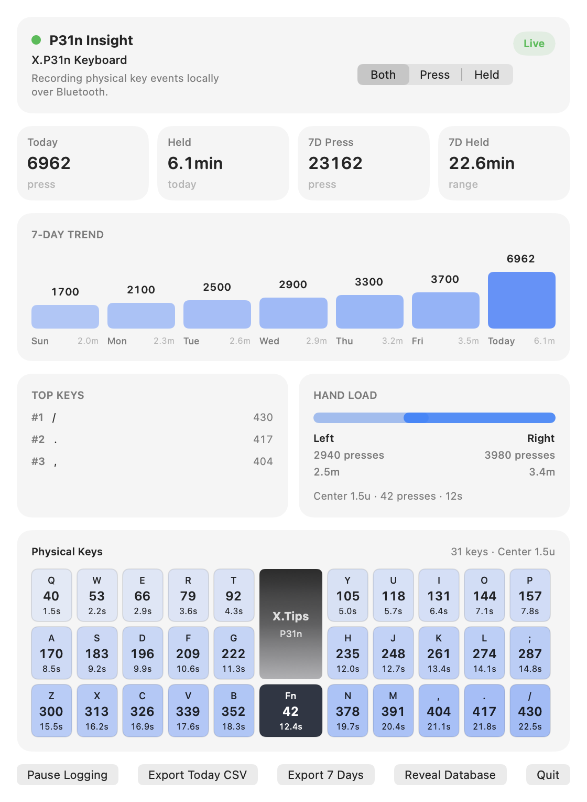

# P31n Insight

原生 macOS 菜单栏应用，通过蓝牙采集 X.Tips P31n 的物理按键事件，保存到本地 SQLite，展示按键次数、按住时长、热力图、七日趋势和左右手负载。

P31n Insight 是 [minix-insight](https://github.com/xhugoliu/minix-insight) 的姊妹项目，复用其存储与仪表盘设计，采集层改为 ZMK BLE GATT。日常使用无需运行 ZMK Studio，不读取系统文本输入，也不需要辅助功能或输入监控权限；首次运行需允许蓝牙访问。

## 实物布局

31 键：左右各 `3×5` 白色键，中间底排一颗 **1.5u 黑色键**。中央键的物理位置是 `25`，矩阵位置是 `row=2, col=5`。热力图保留其尺寸和颜色；中央键单独统计，不默认归入左手或右手。键面字母是位置参考，不表示当前层实际输出。



## 构建和运行

需要 macOS 14+、Swift 6+ 和 Apple Command Line Tools 或 Xcode。

```sh
./scripts/test.sh
./scripts/package_app.sh
open "dist/P31n Insight.app"
```

键盘需运行含遥测模块的固件。固件源码和 UF2 位于 [ZMK-Keyboard](https://github.com/xhugoliu/ZMK-Keyboard/tree/main/modules/p31n-telemetry)，其中 `p31n/p31n.conf` 启用遥测，本地脚本和 GitHub Actions 会包含模块。仓库内 UF2 使用公开占位宏；本地个人宏只用于个人构建，不包含在公开固件中。

首次运行前退出 Telemetry Probe，用蓝牙连接 P31n。菜单栏面板支持暂停/继续、断连自动恢复、按次数/时长切换指标、CSV 导出和定位数据库。遇到蓝牙权限或固件问题时，面板显示对应原因并提供重新连接。

数据目录：`~/Library/Application Support/P31n Insight/`，数据库为 `p31n-insight.sqlite3`。它与 Minix Insight 的数据库独立。采集应用未运行期间不记录，也不从键盘补录离线历史。

## 验证与调试

- [技术路线及真机验证步骤](docs/validation.md)
- [协议及会话规则](docs/protocol.md)，[机器可读协议](protocol.json)
- [2026 年 10 月 10 日真机验证结果](docs/validation-results.json)
- [P31n Telemetry Probe 源码](Tools/TelemetryProbe/Sources)
- 受控测试事件保存在 `Tests/P31nInsightTests/Fixtures/`，可离线重放；普通打字日志不进入仓库。

运行独立 Probe：

```sh
./Tools/TelemetryProbe/build.sh
open "dist/P31n Telemetry Probe.app"
```

同一时间使用一个采集程序。使用 Probe 前退出 P31n Insight，使用正式面板前退出 Probe；两者使用同一遥测服务和采集控制命令。

## 当前验证范围

纯蓝牙连接、A 键精确计数、B＋N 并击、Q 的短按/长按计时及断电自动重连已通过真机验证。自动测试还覆盖 31 键映射、中央 1.5u 几何、计时回绕、会话切换、丢事件后的时长处理及 SQLite 读写。续航影响、长期运行、Mac 睡眠恢复和蓝牙档位切换仍需后续测量。

初始统计和界面来源于 minix-insight 提交 `d2857e0`。固件遥测模块通过 ZMK 的外部模块机制集成，未修改 ZMK 上游。
